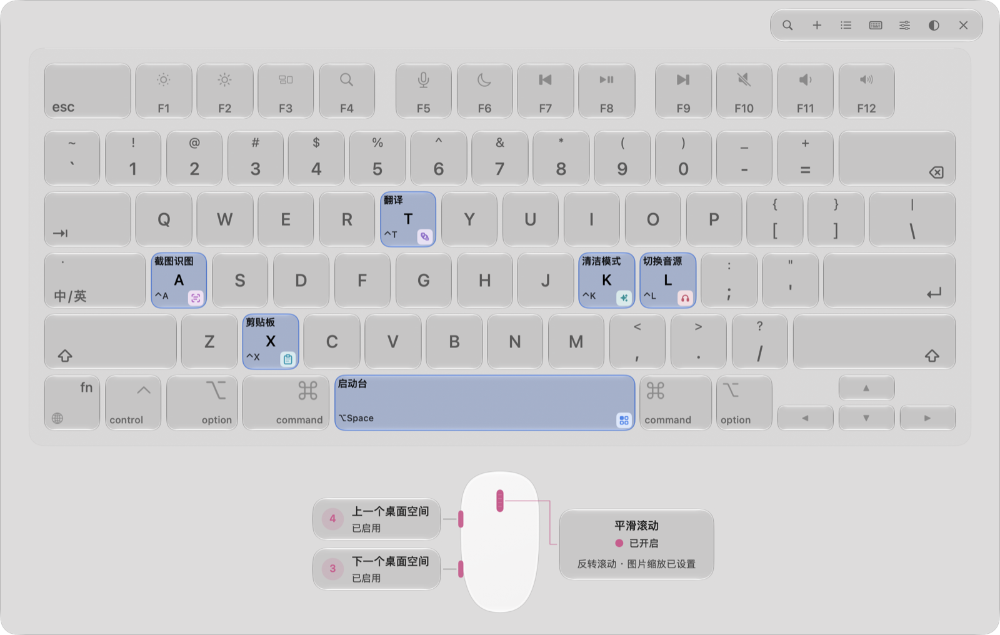
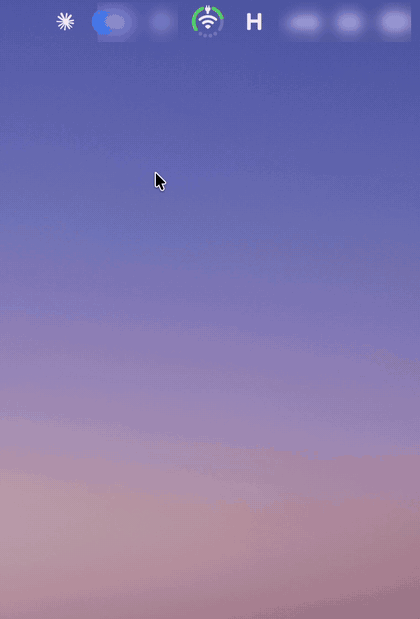
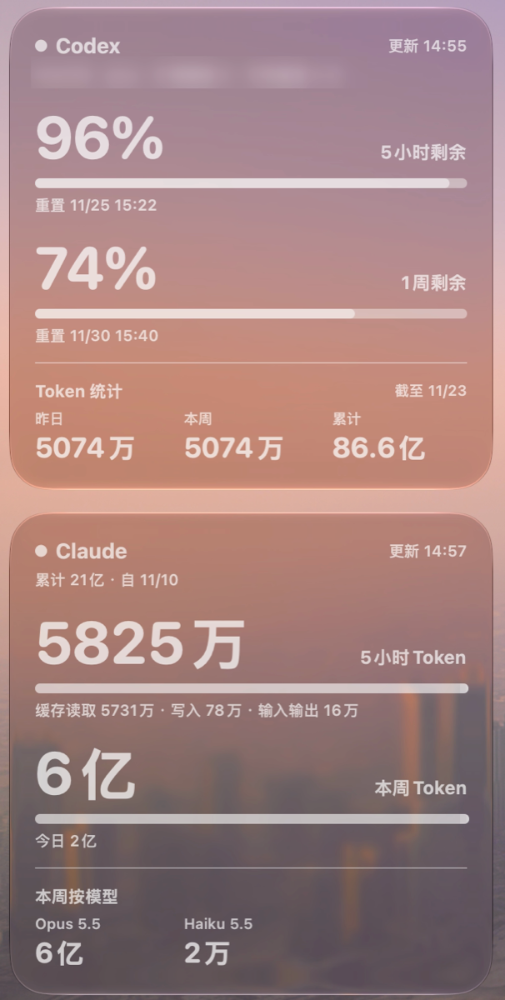
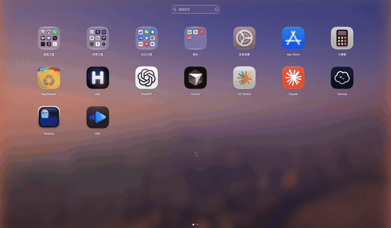
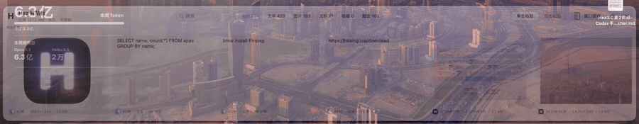
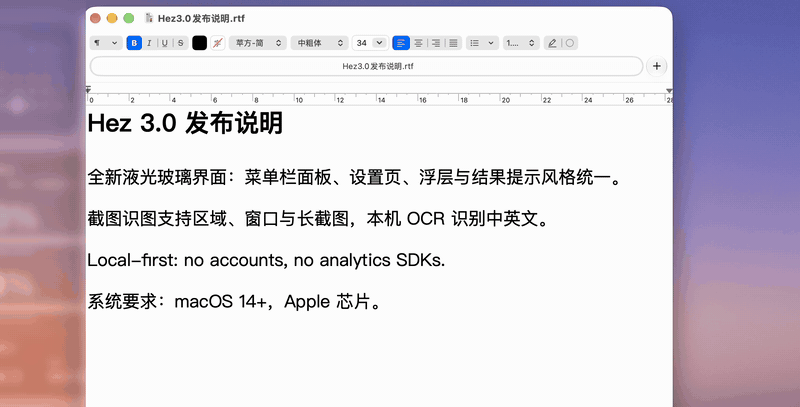
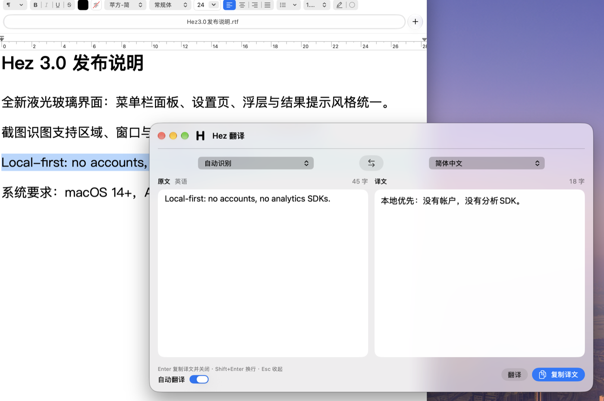
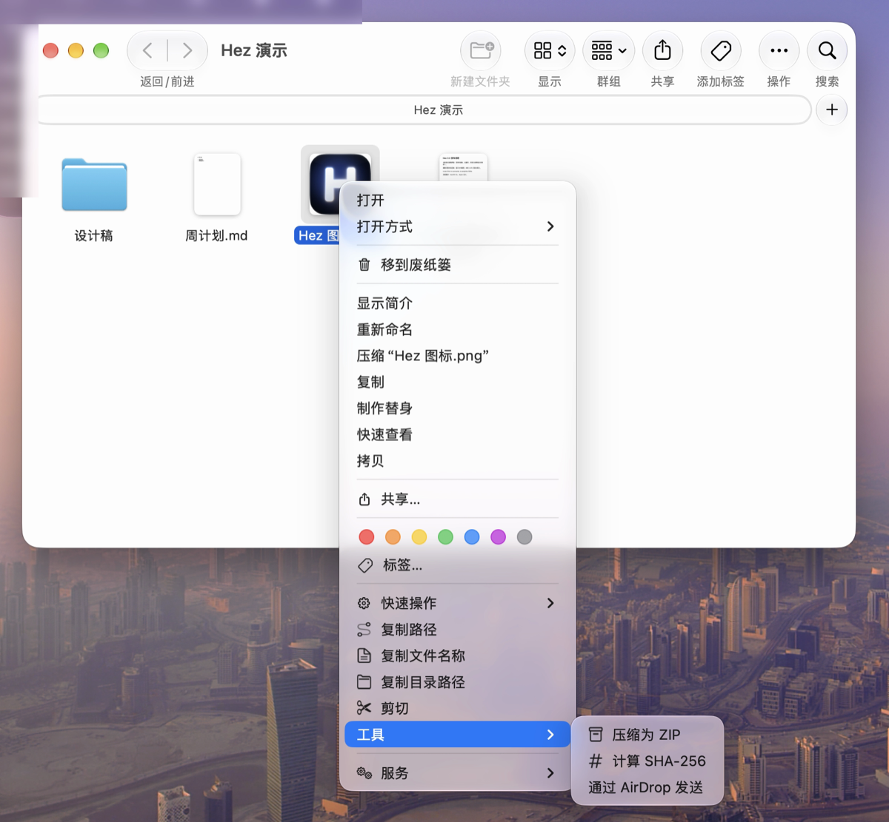
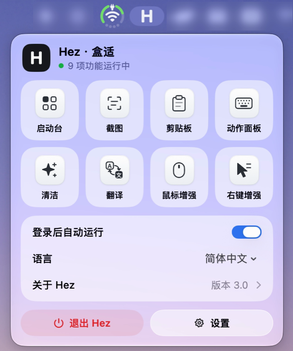

# Hez · 盒适

**把常用的 macOS 小能力，收进一个安静、原生、清晰的工具盒。**

用量统计、启动台、键鼠动作、鼠标与右键增强、截图识图、剪贴板、快捷操作、系统状态，一个 App 全部搞定。

[**下载**](https://hitaing.top/download) · [官网](https://hitaing.top/) · [更新日志](https://hitaing.top/changelog) · [隐私政策](https://hitaing.top/privacy) · [反馈](https://github.com/hita126/Hez/issues)

<!-- hez-current-release:start -->
**当前版本：Hez 3.0（Build 48）· 免费 · 正式版** · [下载](https://hitaing.top/download) · [查看 SHA-256](https://hitaing.top/updates/public-preview.json)
<!-- hez-current-release:end -->

  <picture>
    <source media="(prefers-color-scheme: dark)" srcset="assets/screenshots/actionpanel-dark.png">
    
  </picture>

## 为什么是 Hez

Mac 上的小工具越装越多，菜单栏挤满图标，每个都有自己的设置页和权限弹窗。Hez 把日常最常用的九项能力收进同一个 App：

- **一处管理**：每项功能独立启停，权限、诊断、配置导入导出都在同一个地方。
- **原生手感**：SwiftUI + AppKit 打造，跟随系统深浅色，3.0 起采用统一的液光玻璃界面。
- **本地优先**：能在本机完成的处理不上传，权限只按功能实际需要申请。
- **安静运行**：关掉主窗口后在菜单栏待命，不制造无意义的通知。

## 功能一览

| | 功能 | 一句话 |
| :-: | --- | --- |
| 📊 | **用量** | Codex 5 小时与每周剩余额度、Claude Code Token 统计，带浮窗与桌面小组件 |
| 🚀 | **启动台** | 熟悉的网格与搜索，拖拽整理文件夹，适配不同屏幕比例 |
| ⌨️ | **动作面板** | 一张键鼠地图集中管理快捷键：Hez 功能、App、文件、网页、快捷指令、Shell |
| 🖱️ | **鼠标增强** | 外接鼠标平滑滚动、方向反转、侧键切换桌面空间、触控板模拟中键 |
| 📁 | **右键增强** | Finder 右键补上复制信息、新建文件、压缩、校验等常用操作 |
| ✂️ | **截图识图** | 区域 / 窗口 / 长截图，标注、遮挡、水印、放大镜，本机 OCR，截图钉在桌面 |
| 📋 | **剪贴板** | 文本、图片、文件历史，搜索、收藏、直接粘贴，底部面板或浮动窗口 |
| ⚡ | **快捷操作** | 选词翻译、清洁模式（擦键盘时锁定输入）、一键切换音频输出 |
| 🌡️ | **系统状态** | 菜单栏查看网络、电池、CPU、内存与磁盘（含外接硬盘） |

## 界面预览

<table>
  <tr>
    <td width="50%" valign="top" align="center">
      
      
<b>系统状态</b> 菜单栏一点就开：电池、网络、声音、显示器、蓝牙，CPU / 内存 / 硬盘还能展开看详情

    </td>
    <td width="50%" valign="top" align="center">
      <picture>
        <source media="(prefers-color-scheme: dark)" srcset="assets/screenshots/usage-widgets-dark.png">
        
      </picture>
      
<b>AI 用量</b> Codex 5 小时 / 每周剩余额度、Claude Code Token，直接放在桌面上

    </td>
  </tr>
  <tr>
    <td colspan="2" valign="top" align="center">
      
      
<b>启动台</b> 快捷键唤起，网格、分页、文件夹，输入即搜

    </td>
  </tr>
  <tr>
    <td colspan="2" valign="top" align="center">
      
      
<b>剪贴板</b> 快捷键从底部弹出，文本、图片、文件历史一排排开，单击即粘贴

    </td>
  </tr>
  <tr>
    <td width="50%" valign="top" align="center">
      
      
<b>截图识图</b> 快捷键框选，标注、遮挡、放大镜、识字、钉图都在一条工具栏里

    </td>
    <td width="50%" valign="top" align="center">
      
      
<b>选词翻译</b> 选中文字按快捷键，原文与译文并排，一键复制

    </td>
  </tr>
  <tr>
    <td width="50%" valign="top" align="center">
      
      
<b>右键增强</b> Finder 右键直接复制路径、文件名，压缩为 ZIP、计算 SHA-256

    </td>
    <td width="50%" valign="top" align="center">
      <picture>
        <source media="(prefers-color-scheme: dark)" srcset="assets/screenshots/menubar-dark.png">
        
      </picture>
      
<b>菜单栏</b> 八个常用功能一键直达，九项功能运行状态一眼看清

    </td>
  </tr>
</table>

以上均为 Hez 3.0 正式版实机截图与录屏，图片支持时按系统深浅色切换；Wi-Fi 名称、账号与其他个人信息已模糊处理，演示内容为示例数据。

## 安装

1. 从[官网下载页](https://hitaing.top/download)或 [GitHub Releases](https://github.com/hita126/Hez/releases/latest) 下载 DMG（附件里的 `Hez-x.x-xx.dmg`，不是 Source code），可用 SHA-256 校验完整性。
2. 打开 DMG，把 **Hez** 拖进“应用程序”。
3. 首次打开如被拦截：**系统设置 → 隐私与安全性 → 仍要打开**（DMG 和 App 各需放行一次）。
4. 按 Hez “权限”页授予 **辅助功能** 与 **输入监控**；需要 Finder 右键增强时，在系统扩展里启用 Hez RightClick。

> Hez 免费提供，使用 Apple Development 证书签名，未经 Apple 公证，所以首次打开需要手动放行。请不要为此关闭 macOS 的全局安全检查。

之后的版本可在 Hez 内“检查更新”一键安装，安装前会校验 SHA-256、签名团队与 App 身份。

**系统要求**：macOS 14 或更高版本，Apple 芯片（arm64）。选词翻译需要 macOS 15+。

## 3.0 有什么新变化

- **全新液光玻璃界面**：菜单栏面板、设置页、浮层与结果提示风格统一；设置页去掉大段说明，整行可点。
- **用量新增 Claude**：读取本机 Claude Code 的 Token 用量，有独立浮窗和桌面小组件。
- **系统状态**：外接硬盘与本机磁盘同样显示；CPU 与内存显示“用量 / 总量 · 已用%”。
- **更轻、更稳**：剪贴板图片后台处理、多屏平滑滚动更稳、启动台内存更省、右键菜单连续操作更可靠。

从 2.x 升级会保留现有设置，2.x 导出的配置仍可导入。完整记录见 [CHANGELOG.md](CHANGELOG.md) 或[官网更新日志](https://hitaing.top/changelog)。

## 设计原则

- **原生体验**：优先使用 SwiftUI、AppKit 与 macOS 系统能力，不套网页壳。
- **本地优先**：可在本机完成的处理不上传；没有账号体系，没有统计 SDK。
- **清晰可控**：九项功能分别启停，权限状态与诊断集中展示。
- **轻量**：功能多而不杂，关闭的功能会释放对应的后台任务。

## 隐私

Hez 不收集个人数据。剪贴板、截图、用量快照、动作面板配置都只保存在你的 Mac 上；联网只有版本检查、Codex 用量（经本机 Codex 服务连接 OpenAI）和你主动触发的操作。详见 [PRIVACY.md](PRIVACY.md) 与[官网隐私政策](https://hitaing.top/privacy)。

## 常见问题

<b>为什么打开时提示“无法验证开发者”？</b>

Hez 是免费软件，没有走 Apple 付费公证流程。按上面安装第 3 步在“隐私与安全性”里放行即可，只需一次。

<b>支持 Intel Mac 吗？</b>

目前只提供 Apple 芯片（arm64）版本。

<b>授权了权限，功能还是不工作？</b>

以 Hez “权限”页显示为准：辅助功能和输入监控都要显示已授权。更新后系统偶尔需要重新勾选一次；仍有问题请在 Issue 里附上“通用 → 诊断信息”中适合公开的内容。

<b>源码开放吗？</b>

这个仓库用于发布说明、版本记录和公开反馈。Hez 的应用源码目前没有公开，也没有授予开源许可。

## 反馈

欢迎在 [Issues](https://github.com/hita126/Hez/issues) 提交问题或建议，最好附上 macOS 版本、Mac 型号、Hez 版本与 Build、复现步骤。请勿在公开 Issue 中贴出账号、令牌、个人文件或完整本机路径；安全问题请看 [SECURITY.md](SECURITY.md)。

如果 Hez 帮到了你，点个 ⭐ Star 就是最大的支持。

---

<b>English</b>

**Hez** is a free, native macOS utility that brings nine everyday tools into one calm, consistent app: Codex & Claude usage, Launcher, an Action Panel for keyboard and mouse bindings, Mouse enhancements, Finder RightClick actions, Screenshot & OCR, Clipboard history, Quick Actions (translation, Clean Mode, audio output switching) and System Status.

- Requires macOS 14+ on Apple silicon.
- Download from [hitaing.top/download](https://hitaing.top/download). The app is signed but not notarized, so allow it once in *System Settings → Privacy & Security*.
- Local-first: no accounts, no analytics SDKs. See the [privacy policy](https://hitaing.top/privacy).
- This repository hosts release notes and public feedback; the app source code is not published here.

