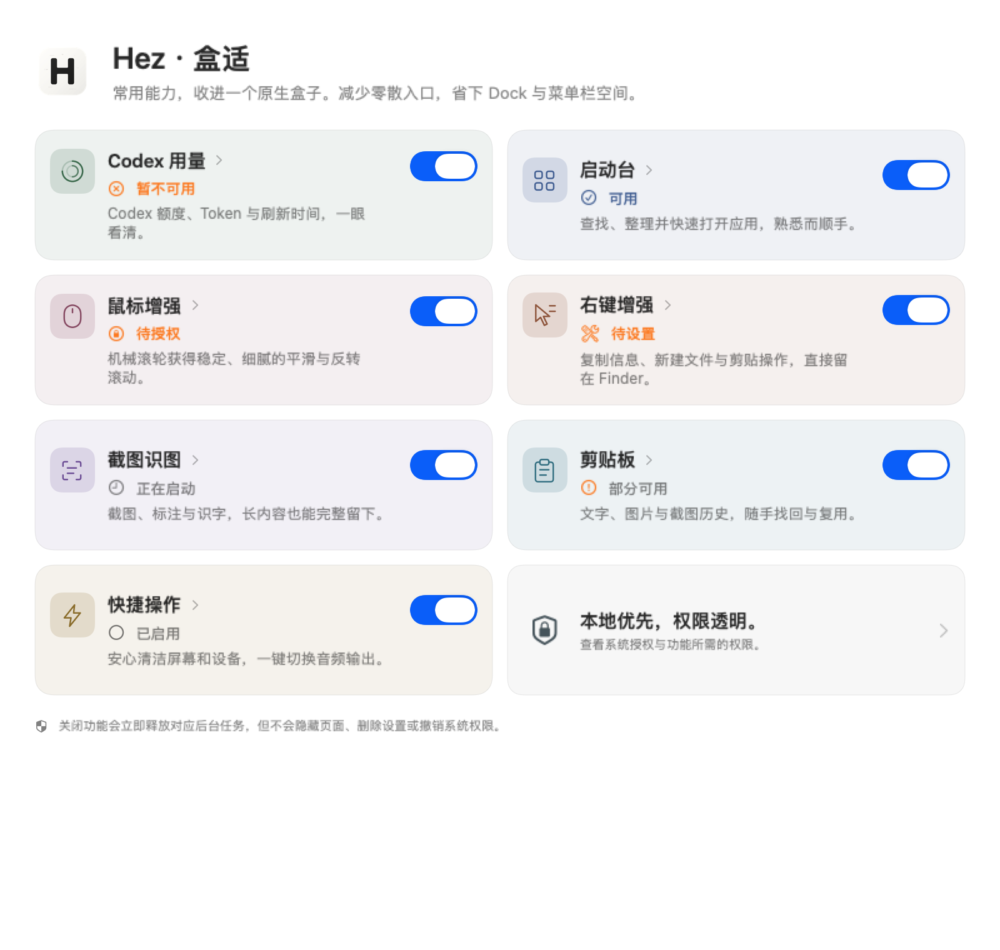
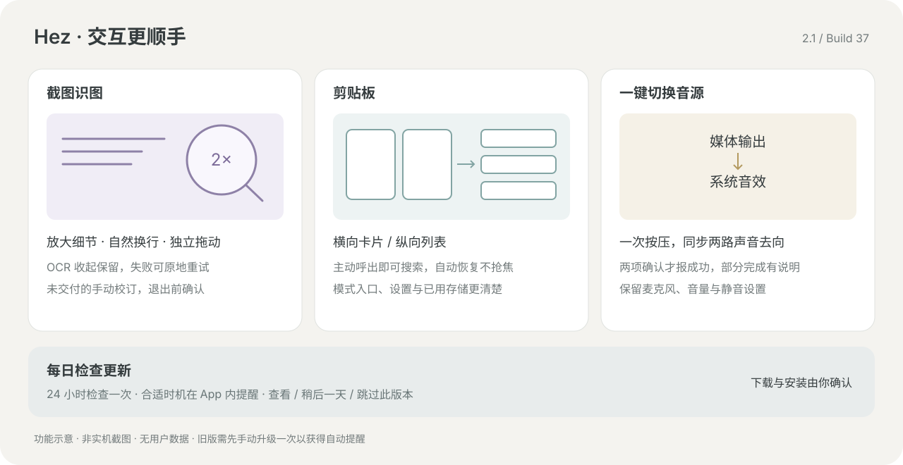
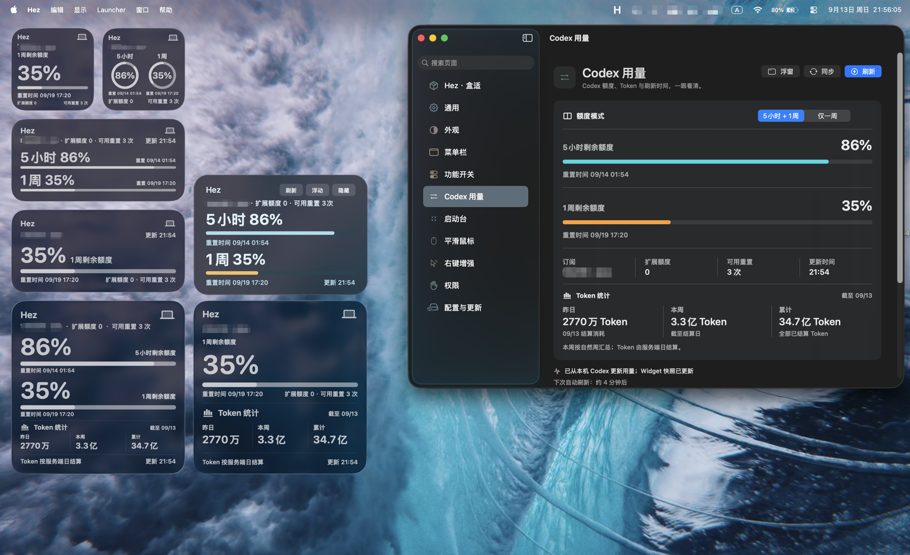
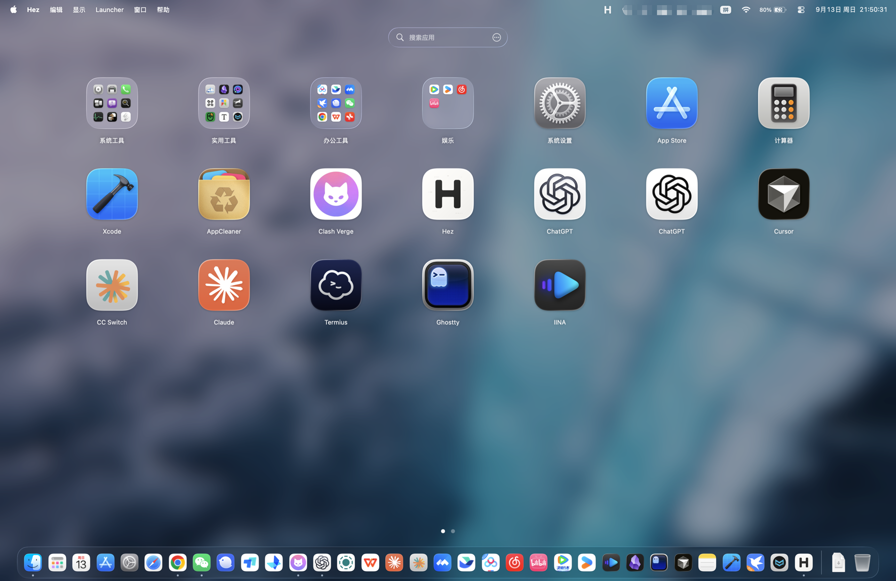
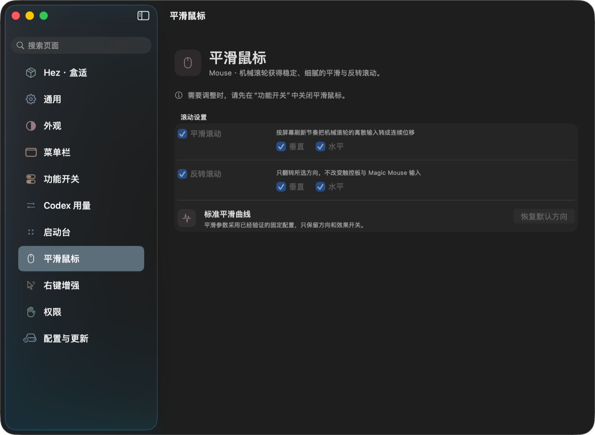
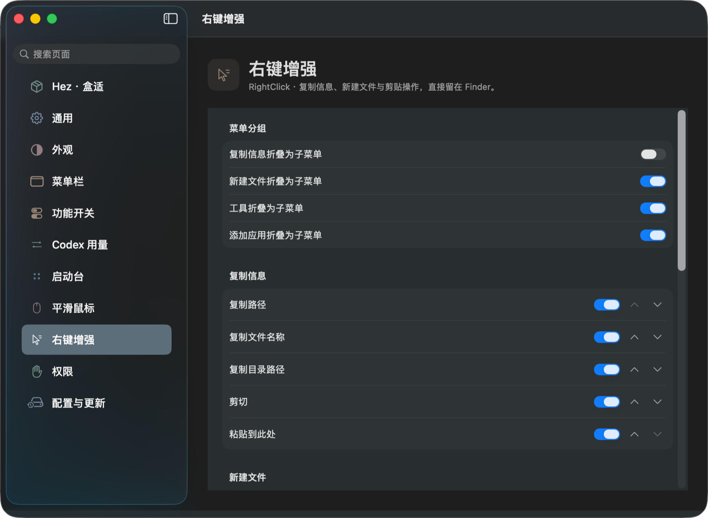
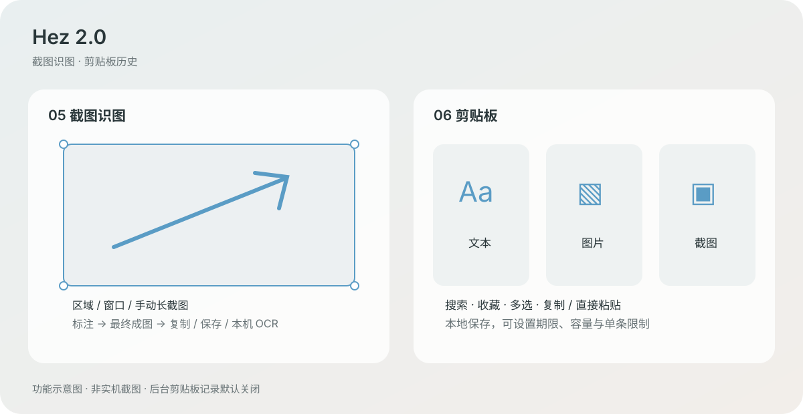
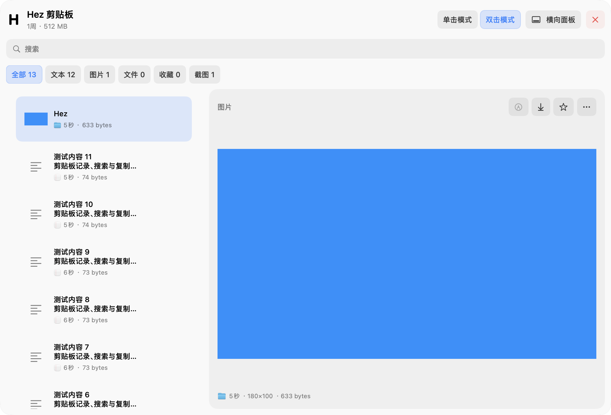
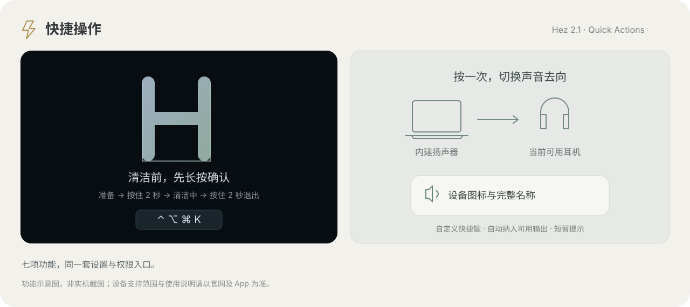

  
  <h1>Hez · 盒适</h1>
  
把常用的 macOS 小能力，收进一个安静、原生、清晰的工具盒。

  

    <a href="https://hitaing.top/">官网</a> ·
    <a href="https://hitaing.top/download">下载</a> ·
    <a href="https://hitaing.top/changelog">更新日志</a> ·
    <a href="https://hitaing.top/privacy">隐私政策</a>
  

<!-- hez-current-release:start -->
**当前公开测试版：Hez 2.1（Build 37）** · [下载](https://hitaing.top/download) · [查看 SHA-256](https://hitaing.top/updates/public-preview.json)
<!-- hez-current-release:end -->

<picture>
  <source media="(prefers-color-scheme: dark)" srcset="assets/screenshots/hez-home-build36-synthetic-dark.png">
  
</picture>

首页控制台示意由生产视图与合成状态离屏渲染，不含账户或本机数据。

## Hez 是什么

Hez 是一款原生 macOS 效率工具，将七项日常能力统一到一个 App 中，减少零散应用对 Dock 与菜单栏空间的占用，也让常用设置、权限和诊断拥有一致的入口。

| 功能 | 作用 |
| --- | --- |
| Codex 用量 | 在本机读取并展示 Codex 使用额度与刷新状态 |
| 启动台 | 用熟悉的网格与搜索方式快速打开应用 |
| 鼠标增强 | 改善外接机械鼠标的滚动手感，并提供方向、侧键、图片缩放和 Dock 点击设置 |
| 右键增强 | 为 Finder 补充复制信息、新建文件、压缩与校验等常用操作 |
| 截图识图 | 区域与窗口截图、手动长截图、文字标注、放大镜及带校订保护的本机 OCR |
| 剪贴板 | 横向卡片或纵向常驻窗口，主动呼出即可搜索，支持收藏、复制与直接粘贴 |
| 快捷操作 | 全屏清洁模式保护输入，通过自定义快捷键同步切换音频输出和系统音效 |

## 界面预览

早期实机截图来自 Hez 1.0（Build 21），账户与本机信息已脱敏；新版功能示意分别标注版本和来源。实际界面会随版本迭代调整。

### 本次交互更新（Hez 2.1 Build 37）

截图新增放大镜并改善拖动跟随，文字、备注与编号支持自然伸展和换行，标签可独立拖动。OCR 收起后保留本次文字，失败可原地重试；未复制的手动校订在退出或替换前确认。剪贴板主动呼出即可搜索，自动恢复不额外抢焦，横向卡片与纵向列表的入口、设置和存储说明更清楚。

一键切换音源同时同步系统音效，两项都确认后才显示成功；无法同步音效时明确提示部分完成。新增默认每 24 小时一次的版本检查，可关闭、延后一天或跳过当前版本；发现新版在主窗口的合适时机提醒，下载与安装仍需确认。旧版用户需先手动升级到本版，之后才能收到自动更新提醒。

### 首页状态与统一设置（Hez 2.1 Build 36）

“Hez · 盒适”首页集中七项功能的运行状态、独立启停和设置入口，不再单独设置“功能开关”页。七个功能共享设置分组、快捷键录制、按钮层级与自适应布局；高级选项按需展开，权限与诊断集中管理。功能图标、莫兰迪配色与柔和面板同时适配浅色和深色。

首页按实际就绪情况区分可用、部分可用和暂不可用，诊断使用相同口径；返回 App、唤醒或恢复会话时重新检查相关权限。Build 36 同时完善截图 Esc 分层与预览收起、剪贴板跨模块启用确认、配置导入恢复、更新原子替换及 ZIP 预检，详见[完整更新日志](https://hitaing.top/changelog)。

剪贴板存储时间与上限可直接点选，窄窗口自动换排；长表单在溢出时显示纵向滚动条，历史内容区继续保留自己的横向浏览。

### Codex 用量

集中查看 5 小时与每周剩余额度、重置时间和 Token 统计，并提供多种尺寸的桌面小组件。

### 启动台

通过网格、分类和搜索快速找到应用，也可整理和隐藏不常用项目。

### 鼠标增强

为外接机械鼠标提供平滑与反转滚动，并可分别控制垂直、水平滚动方向。按需开启侧键切换桌面空间、微信图片滚轮缩放，以及再次点击前台 App 的 Dock 图标收起当前窗口；后者也支持触控板点击。

### 右键增强

按需配置 Finder 右键菜单中的复制信息、新建文件、剪切、粘贴及其他常用操作。

### 截图识图与剪贴板

截图识图提供标注、隐私遮挡、水印、圆角和本机 OCR；复制、导出及历史均使用最终成图。剪贴板后台记录默认关闭，支持保留时长、容量及单条大小限制，也可清除历史和打开存储文件夹。文件记录仅保留引用，不复制原文件。

上图是功能示意图，不是实机截图。截图留存由独立开关控制，Dev 与公开版本数据隔离；隐私与权限细节见[隐私政策](https://hitaing.top/privacy)。

### 剪贴板常驻窗口（Hez 2.1 Build 34）

通过右上角“窗口面板 / 横向面板”或设置切换布局。窗口顶部标题和空白处均可拖动，宽高可调并在本机记住；切换应用或复制后继续显示。左侧纵向浏览历史，右侧独立预览，搜索、分类、多选与收藏沿用已有操作。关闭按钮、Esc 或再次按快捷键可收起；直接粘贴确认当前输入目标，不自动发送消息。

上图由生产视图使用合成内容离屏渲染，不含用户剪贴板数据。

### 快捷操作（Hez 2.1）

从菜单栏“清洁模式”进入全屏准备画面，按住组合键 2 秒确认；默认 ⌃⌥⌘K，可自定义。清洁中拦截可捕获的键盘、鼠标与触控板点击和滚动，降低支持调节的屏幕亮度。按住同一组合键 2 秒退出，固定备用退出为 ⌃⌥⌘Esc、5 秒。清洁模式按需使用辅助功能与输入监控权限，不禁用 Touch ID、电源键，也不保证拦截所有系统多指手势。

设置音频切换快捷键后，单次按压即可在当前可用输出设备之间循环切换，无需勾选或排序。确认成功后短暂显示设备图标和完整名称；同步默认音频输出和系统音效输出，两项都确认后才显示成功；设备不支持音效或同步失败时明确提示部分完成。不改麦克风、音量或静音，不主动连接蓝牙或 AirPlay。

上图为功能示意图。七项功能统一设置分组、快捷键录制与按钮层级，启停集中在“Hez · 盒适”首页，权限统一在“权限”页面管理。首页同时提供功能状态、独立启停与设置入口，浅色和深色共用克制的莫兰迪图标与柔和面板。

## 产品原则

- **原生体验**：优先采用 SwiftUI、AppKit 与 macOS 系统能力。
- **本地优先**：可在本机完成的处理不上传；权限按功能实际需要使用。
- **清晰可控**：七项功能可分别启停，权限状态与诊断集中展示。
- **安静运行**：主窗口关闭后仍可由菜单栏唤回，不制造无意义通知。

## 系统要求

- macOS 14 或更高版本
- Apple 芯片 Mac（arm64）

当前提供的是未公证公开测试版。首次安装及启用 Finder、输入监听等系统能力时，请以[下载页](https://hitaing.top/download)的说明为准。

## 反馈与建议

欢迎通过 [Issues](https://github.com/hita126/Hez/issues) 提交问题或功能建议。报告问题时，建议附上：

- macOS 与 Mac 型号
- Hez 版本和 Build
- 可复现步骤与实际结果
- “通用 → 诊断信息”中适合公开的内容

请勿在公开 Issue 中提交账户信息、访问令牌、个人文件内容或其他敏感数据。安全问题请查看 [SECURITY.md](SECURITY.md)。

## 关于源码

此仓库用于 Hez 的产品说明、版本信息与公开反馈管理。Hez 应用源码目前未在此仓库公开，也没有授予开源许可。

---

Hez is a native macOS utility that brings Codex Usage, Launcher, Mouse, RightClick, Screenshot &amp; OCR, Clipboard and Quick Actions into one calm, consistent app. Product source code is not currently published in this repository.
